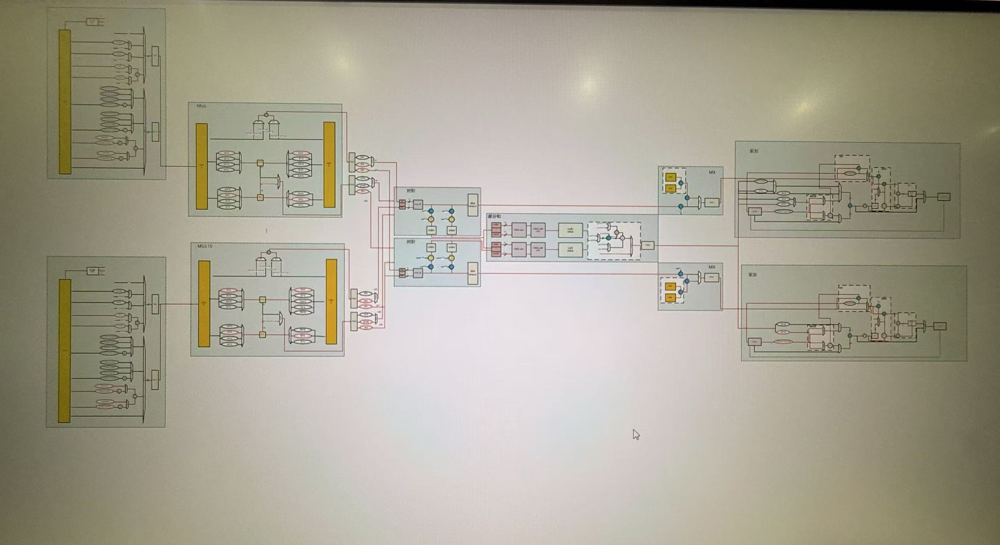

# 面向多格式量化计算的动态可配置多精度融合 MAC 设计

> 本文保留原项目总结；2026-10-31 的旧基线现状和证据边界见[项目状态](status.md)，2026-11-05 起的新架构约束见[已确认约束](decisions.md)。后续架构与任务由用户确定。

**项目概述：本课题设计一套能够在运行时选择不同精度模式的乘累加电路，让常用整数格式、浮点格式及块缩放格式共用主要计算资源。当前已完成核心电路和完整计算链路的功能验证，也为后续格式扩展建立了结构基础。**

**与开源项目对比：调研了目前一些的开源项目，最大优势是一套电路实现不同精度格式的乘累加。一些项目往往采用静态编译的方式来实现不同精度格式的计算，综合后就只能计算单一精度格式或两三个精度格式**

## 1. 题目与研究目标

**题目：面向多格式量化计算的动态可配置多精度融合 MAC 设计。**

本课题希望解决的问题是：**当模型使用不同数据精度时，通过配置同一套电路完成计算，同时充分利用低精度带来的并行机会，并降低接入新格式的改动成本**

具体目标包括：

- **一套电路兼容多种精度：**通过运行时配置选择计算模式，共用乘法、求和与累加资源。
- **覆盖当前常用计算需求：**兼顾 FP16、BF16、FP8 及多种整数精度，并支持块缩放计算(MX,NVFP4)。
- **为格式演进留下适配空间：**将输入格式的解释与内部运算组织分开，使后续新格式有机会复用已有核心电路。

## 2. 背景
该设计主要针对当前的LLM推理往往不是使用一种单一的精度格式，而是混合使用不同的精度格式(根据量化方法的不同)。且当前LLM结构和量化算法的发展很快，低精度的量化格式在LLM推理上已经达到了很不错的效果，且吞吐率哥高。
项目主要解决混合精度和低精度在MAC乘累加单元上的实现。

## 3. 大致原理与设计优点

整体计算流程为：

**输入格式适配 → 共享乘法计算 → 块内对齐与求和 → 块缩放处理 → 累加保存**

每个计算块处理 16 对数据，即完成一次“16 项乘积相加”。较长的点积由多个计算块持续累加得到。这里的“融合”主要体现在不同精度共用主要计算资源，并通过统一流程衔接乘法、求和和累加。

参考了华为昇腾的cube三维张量计算核心

### 3.1 用统一内部表示连接不同外部格式

输入数据仍采用各自原有的紧凑编码，进入计算单元后再适配到两类内部浮点表示：FP16、BF16 使用一类，两种 FP8 使用另一类。它们分别称为 FP19 和 FP9，是内部计算表示，作用是统一后续电路的处理方式。

当前实现范围如下：
| 格式类别 | 当前支持 | 主要作用 |
|---|---|---|
| 16 位浮点 | FP16、BF16 | 兼顾不同精度和数值范围需求 |
| 8 位浮点 | FP8 E4M3FN、E5M2，以及两者交叉相乘 | 支持低精度浮点计算 |
| 整数 | INT16、INT8、INT4 | 支持多种整数精度；输入采用对称量化范围 |
| 块缩放 | MXFP8、MXINT8 的计算路径 | 利用共享缩放因子衔接低位宽数据与浮点累加 |

已实现的浮点交叉格式相乘限定于两种 FP8；FP16 与 BF16 当前各自同格式计算。上述功能在当前已定义的输入范围内完成验证。后续可以添加非对称格式的计算，以及FP4这类极低精度浮点格式

### 3.2 同一套资源随精度改变计算组织

乘法部分由 16 个相同的计算前端组成，每个前端包含一大一小两个有符号乘法器。通过改变数据映射方式，同一批资源可以承担不同任务；后面的两棵求和树也在不同模式下复用。
**这一设计的优势是既能处理较宽数据，也能在低精度模式下增加并行计算量。**两组低精度计算具有独立的累加状态，可以分别推进不同结果。当前 INT4 与 INT8 均采用双组组织，尚未进一步增加 INT4 并行路数(这也是当时因为面积考虑而没有增加的点)

### 3.3 将块缩放与统一累加连成完整路径
块放缩是近期主流的精度格式，像华为昇腾和英伟达在自己的芯片上都已经原生支持了。
块缩放可以理解为“一组小数值共用一个放大倍数”。本设计先在同一缩放组内完成乘法和求和，再统一调整部分和的尺度。对当前采用的二进制幂缩放因子，这一调整主要体现为指数修正。

**这样可以在块级集中处理尺度信息，减少逐项恢复尺度的需求。**

浮点及 MXINT8 路径随后进入统一的扩展精度累加器。累加器内部采用较宽的寄存器存储累加结果，这样做的目的是保留较高的精度，也为后续输出不同的精度格式确定好了基础

### 3.4 为后续格式演进建立适配基础
当前设计已经具备输入格式适配、统一内部表示、源格式指数修正和独立块缩放处理等结构。这些机制使新增格式有机会沿用现有的乘法、求和与累加电路。
例如，对于尚未接入的 FP4、FP6，如果其有效位数和指数需求能够映射到现有内部表示，就有望通过扩展入口适配和控制规则复用核心计算通路。这是根据现有结构作出的扩展判断，还需要具体实现与验证。
因此如果后续需要增加也能够快速实现。

## 4. 目前的结果与继续研究的判断

### 4.1 已完成的工作
1. 前期调研工作，包括有哪些精度格式，他们是如何量化的；主流的量化算法；一些厂商产品支持的精度格式
2. 单独一种精度格式的MAC电路图(需重新绘制)，用来判断资源如何复用，预估要支持某种精度格式所需要的资源
3. 整体设计的设计说明，详细介绍了每个模块的功能，如何实现，需要考虑哪些点
4. 数值实验，确定一些浮点格式加法中的中间位宽，直接影响电路设计和结果准确度
5. 整体设计的电路图(需要重新绘制)
6. 整体设计的 RTL 代码，并在验证环境中验证了完整计算链路。
下面是我的电路设计图：

**当前进展表明项目已从架构设想推进到可运行、可对照验证的核心硬件原型。**功能验证支持其实现可行性，综合后的PPA需要重新跑

